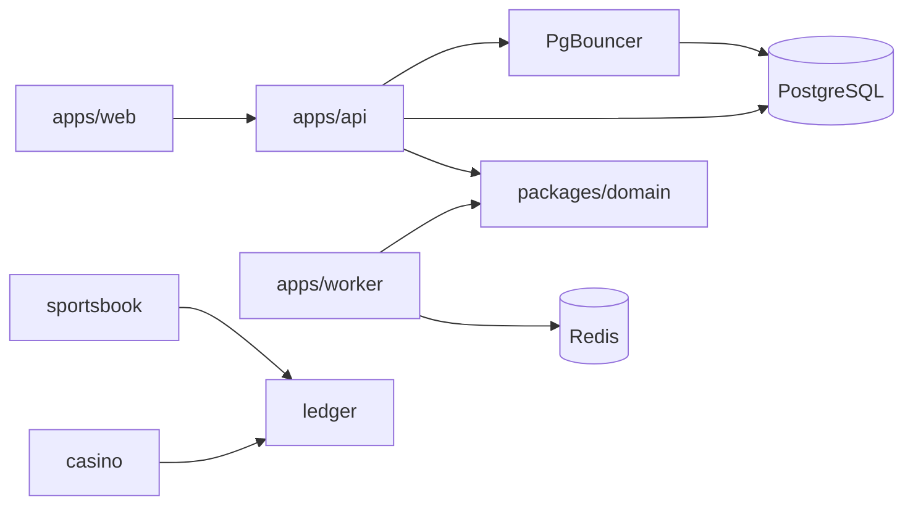

# Architecture

FABLE is one modular monolith plus one worker process. The web app, the API, and the worker share domain types. They are not a fleet of microservices.

## Module boundaries

| Module     | Owns                                    | Balance changes                  |
| ---------- | --------------------------------------- | -------------------------------- |
| identity   | Player directory and sessions           | No                               |
| ledger     | Journals, derived balances, idempotency | Yes, and only simulated journals |
| casino     | Requests a simulated settlement         | No                               |
| sportsbook | Requests a simulated settlement         | No                               |
| providers  | Mock game-provider adapter              | No                               |

The ledger is authoritative. Casino and sportsbook call `Ledger.post` with `simulated: true` hardcoded. They do not import Prisma, and they have no method that sets a balance. A unit test reads those source files and rejects a direct write.

Workers are a separate OS process so a queue stall does not take down HTTP. The only accepted job today is `platform.ping` on the `fable.jobs` queue. Job names that start with `wallet.` or `balance.` are rejected. A financial job, if one is added later, must call the ledger. It must not update a balance column. There is no balance column.

## Processes

- `apps/web` is the player application: discovery, casino previews, the sportsbook, demo slip, auth, and the simulated wallet. The browser calls the API through a same-origin `/backend` rewrite so session cookies stay on the web origin. A missing `fable_session` cookie redirects wallet, transactions, profile, settings, and favorites to login.
- `apps/api` is NestJS on Fastify: health, metrics, OpenAPI, a Socket.IO ping gateway, the ledger wiring, and the player routes (auth, catalog, sports fixtures, demo bets, wallet reads, promotions, favorites).
- `apps/worker` is a thin Node process using BullMQ. It is not a second Nest application, so it cannot accidentally share the API's HTTP server.
- `packages/domain` is pure TypeScript. Persistence lives in `packages/database`.
- `packages/observability` is logging, optional tracing, optional Sentry, and the Prometheus registry.

When `DATABASE_URL` is unset, the API uses an in-memory ledger and an in-memory player directory. Journals and sessions disappear when the process restarts. When the URL is set, `PrismaLedgerStore` commits each journal and its audit row in one Postgres transaction, and `PrismaPlayerStore` keeps users and sessions in Postgres. Favorites remain in process memory. Bet records and original placement responses persist in PostgreSQL with journals when configured; the memory bet store is local-demo only. The ledger remains the balance authority. See [Phase 7](phase-7-financial-integrity.md) for the atomic bet lifecycle and recovery contract.

Demo bets do not add a journal kind. `DemoSportsbook` asks the sportsbook boundary for two simulated sportsbook journals: available wallet to hold, then hold to the wallet and the house. `DemoWallet` posts the opening grant through `Ledger.post` with `simulated: true`. Controllers do not write lines. See [financial safety](financial-safety.md).

## When more infrastructure would be justified

These are not in the repo, and they should not be added to look complete.

**Kafka.** Add a log only when a consumer must resume independently of the API process, for example a regulatory feed or a provider settlement stream that cannot share the API transaction. BullMQ on Redis is enough for the stub jobs this foundation has. A second broker would duplicate the queue without a second consumer.

**Kubernetes.** Add it when more than one team needs independent deploys, autoscaling, and cluster policy. Until then, Docker Compose for local and a normal container host for a single API plus a single worker are the operational surface. The Terraform skeleton records the intended services and applies nothing.

**ClickHouse.** Add a columnar store when ledger or gameplay events are queried as analytics across large history, and Postgres is the wrong place for those scans. The authoritative money record stays in Postgres. ClickHouse would be a derived read model, never the balance authority.

**Pact broker.** A broker pays for itself when several independently deployed consumers need a shared contract pipeline. This repo has one web client and one API, released together. `pact/pact.config.json` names the future consumer and provider. OpenAPI at `/docs` is the contract that exists today. See [CI](ci.md).

**k6 as a CI gate.** `load/k6/health.js` is a one-iteration script. Load is an opt-in measurement, not a correctness check, and the k6 binary is not an npm dependency.

**Testcontainers.** Gated by `FABLE_TESTCONTAINERS=1`. Default CI and this sandbox do not require a Docker daemon for tests. The in-memory ledger and the Supertest health check cover the foundation. See [local development](local-development.md).
