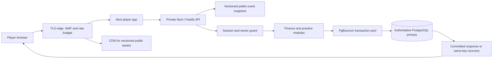
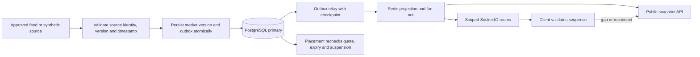
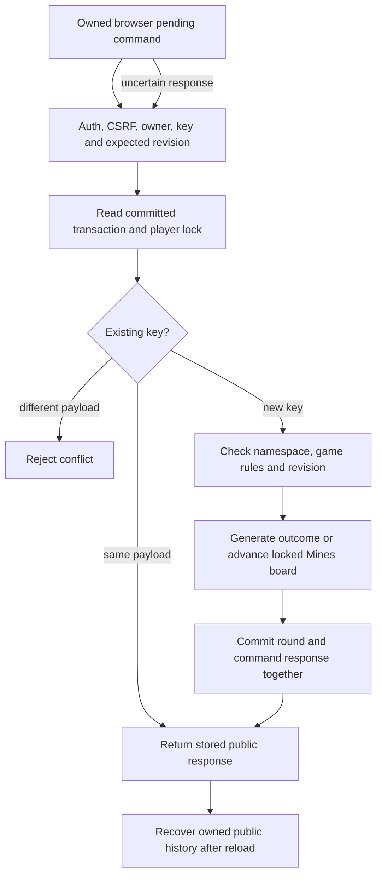
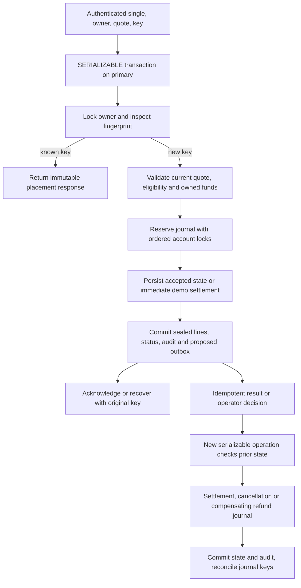
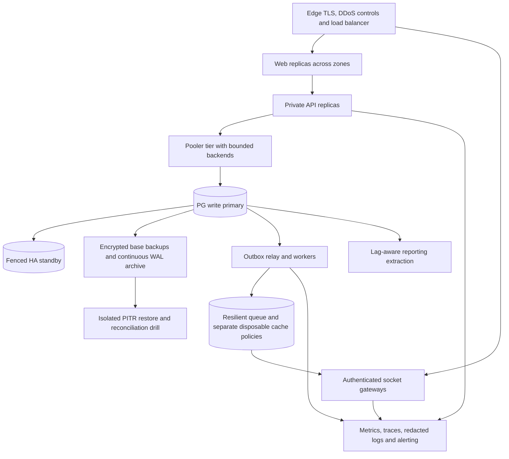

# Throughput, latency and target topology

**As of 9 November 2026.** Read alongside the [decision and roadmap](production-architecture-audit.md), [current request traces](production-audit-player.md), [SQL and lock analysis](production-audit-database.md) and [deployment evidence](production-audit-operations.md). The diagrams in this document are proposed designs. Public odds, provider ingress, production edge, HA, outbox and fan-out components shown below require implementation or provisioning.

## Direct observations

Local ports 4307, 3847 and 55437 refused connections. To measure the two genuinely read-only public API paths, a one-shot Node 22.23.4 process loaded the installed build of AppModule, FastifyAdapter and configureHttp, with database, Redis and telemetry destinations unset, and listened on an ephemeral loopback port. It made sequential HTTP GETs using Node fetch and timed each through consumption of the full response body. Existing compiled output was used without rebuilding, so this also does not attest a fresh build-to-SHA match. No external request, player account, prior cookie, cache eviction or database was part of the benchmark.

- **Startup and first observation.** Nest creation through listen took 11,462 ms after module imports. First event-list response took **135.81 ms** for 12 fixture events. First cricket detail took **11.85 ms** after the event list had already run. These are single observations on a new process. The OS file cache and transport were not independently cold-controlled. Report cold-cache p50/p95/p99 as unavailable.
- **Warm event list** `GET /sports/events`. Five priming requests, then 100 measured, concurrency one. p50 **3.27 ms**, p95 **8.28 ms**, p99 **16.76 ms**, **213.8 completed requests/s**, 0/100 HTTP errors, 21,580 response bytes. Combined client/server process CPU **53.4% of one core** over the timed loop, maximum sampled RSS **149.5 MiB**.
- **Warm cricket detail with odds** `GET /sports/events/crk-ivory-t20`. Five priming requests, then 100 measured, concurrency one. p50 **2.28 ms**, p95 **5.83 ms**, p99 **9.08 ms**, **348.2 completed requests/s**, 0/100 HTTP errors, 4,380 response bytes. Combined process CPU **65.5% of one core**, maximum sampled RSS **139.8 MiB**. This endpoint delivers the whole cricket object. There is no independent live-price read API to time.
- **Interpretation.** Percentiles use the nearest rank among successful responses. Throughput uses completed requests divided by wall time for each measured loop. CPU uses process user+system time over elapsed time, RSS was sampled between requests. The client and server shared a process, the HTTP path omitted Next, TLS and ingress, no DB query was expected, and the sample includes warm local JIT and scheduling effects. Zero observed HTTP errors in 100 calls does not establish an availability budget. No current DB load, lock wait, cross-process latency, peak throughput or live-feed freshness measurement is available. Separate observation of an inactive listener is not a DB stall measurement.
- **Unmeasured SLOs.** Wallet reads may post a grant. Login creates a session, expired-session checking can delete a row, and bet/casino actions intentionally write. No tests against stored records were permitted. Real cold-cache runs, PostgreSQL plans/contended timings, browser-to-commit latency, provider lag, WS fan-out and failover are open gates. k6 source exists but tests one liveness request; k6, Artillery and Locust were unavailable on PATH. [Load script](../load/k6/health.js) · [Wallet read](../apps/api/src/wallet/wallet.service.ts) · [Session lookup](../packages/database/src/prisma-player-store.ts)

## Proposed service objectives

Use a rolling 30-day window and route-specific histograms at the edge and service. For single-bet placement, the service timer ends after the committed response is ready; record an additional metric for user-visible recovery from a lost acknowledgement. Preserve separate labels for new commits, replay, expected business rejects, malformed requests, load shedding, timeouts and transport failures. Count overloaded or failed eligible requests against availability. Never discard retries or slow failures from the end-user distribution. Count recovery and retry attempts separately from unique business commands.

- Event-list and odds read p95 **<100 ms** each. Initial investigation threshold p99 **<250 ms**.
- Wallet primary read p95 **<150 ms** and proposed p99 **<400 ms**.
- Single placement p95 **<250 ms** and proposed p99 **<750 ms**, including database commit, inline validation and synchronous queueing. Record matching end-user click-to-receipt distributions separately.
- Casino action p95 **<150 ms** and proposed p99 **<400 ms**. Measure both HTTP completion and the UI's post-action history refresh.
- Provisional availability target **99.9% of eligible requests per critical route**. This consumes at most one failed request per thousand. A time-based availability SLI with the same percentage has 43.2 minutes per 30 days; compute each budget with its own denominator. Site-wide averages must not hide a failed placement or login route. Publish p50/p95/p99, counts, timeout rates and tail histograms per endpoint. Recalibrate numeric objectives against a production-like baseline and product expectations.
- For a future feed, measure provider-produced → received → durable → visible lag using calibrated clocks, and sequence gaps per topic. As an initial test hypothesis, use internal ingest-to-fan-out p95 <500 ms excluding external transit. Product/feed owners must set the maximum quote age by sport and market. When fresh state cannot be proven, suspend acceptance until corrected. Accepted commands must reconcile exactly even when availability targets are missed.
- Suggested infrastructure design target pending business approval: no acknowledged financial commit loss on the supported single-zone failover, target RTO ≤15 min. Do not promise zero RPO on a total regional loss without a matching synchronous replication design. Set and rehearse a separate regional restore objective, for example RPO ≤5 min and RTO ≤60 min. Test lag, client unknown-commit resolution and WAL recovery as part of that claim.

## Capacity assumptions and arithmetic

**Planning only.** Let N be simultaneous connected browser sessions, assume one socket per session in the proposed push topology. Registered accounts are an independent table cardinality and govern index, storage and retention tests. Multiple tabs/devices can make sessions exceed concurrent people. HTTP in-flight requests, DB sessions, bets per second, PG transactions per second and outbound WS deliveries each have different units.

One representative peak mix below gives **offered business requests per second**, before client retries, invalidations, auth prerequisites, read amplification or a slow-client reconnect storm. Fractions can overlap between routes. Values are shown in order for **10k / 50k / 100k** connected sessions. These are test inputs. They are not measurements, sizing commitments or predicted capacity.

- A quarter browse a list every 30s. `N × .25 / 30` gives **83.3 / 416.7 / 833.3** list RPS.
- 15% read an odds detail every 15s. `N × .15 / 15` gives **100 / 500 / 1,000** detail RPS.
- 6% refresh a wallet every 60s. `N × .06 / 60` gives **10 / 50 / 100** wallet RPS.
- 3% place a single every 60s. `N × .03 / 60` gives **5 / 25 / 50** unique bet commands/s. Separate accepted, rejected, replayed and timed-out counts.
- 6% play a practice action every 12s. `N × .06 / 12` gives **50 / 250 / 500** unique casino commands/s, with a mix of start/reveal/finish. Those commands do not enter the financial ledger.
- 3% request history every 60s and 0.6% log in every 60s. These add **5 / 25 / 50** history RPS and **1 / 5 / 10** login RPS. Session validation on a private endpoint is additional DB work.
- Total offered **254.3 / 1,271.7 / 2,543.3 business requests/s**. At an _assumed_ mean service time of 0.10s, Little's law gives roughly **25 / 127 / 254** mean in-flight HTTP requests before amplification. Replace that placeholder with measured route-specific means and queue time. Bet plus casino demand is **55 / 275 / 550** commands/s; do not label that PostgreSQL TPS. Auth reads, grant replay, autocommit queries, retries and peak skew change DB traffic.
- **Current frontend overhead.** A board polling every 30s fetches `ceil(events/50)` sequential pages per refresh. Detail polling every 30s, selected slips every 15s, focus refetches, session checks, quote checks and post-placement wallet/history invalidations can overlap. Test the current browser's measured request mix separately from the future push model. Estimate board RPS as `active board sessions × pages / 30`. Personalised requests bypass shared caches. [Board loader](../apps/web/src/lib/sports.ts) · [Slip](../apps/web/src/components/bet-slip.tsx)
- **Future WS volume.** Example synthetic hot topic: 10% of sockets subscribe, five changes/s, 250 payload bytes each. That is **5k / 25k / 50k outbound messages/s** or **1.25 / 6.25 / 12.5 MB/s** of payload before framing, TLS, heartbeats and replication. Measure membership overlap, skew and broadcast locality. Account for reconnect snapshot floods, slow devices, proxy idle timeouts and multi-tab duplication. There is no current odds stream.
- **Dimensioning gates.** Allocate file descriptors and memory per measured socket; bound queues per subscription. Allocate PG backends by measured service time and pool saturation with headroom for failover, monitoring and migrations. Add API replicas only while primary lock contention and pool waits remain within budget. Size dataset independently by registered players × active days × journals/rounds/command history and measured row/index/WAL bytes. Test long histories on a few heavy accounts, plus a large unrelated population. Partitioning is a later plan-backed decision.

## Load and failure test protocol

Provision a disposable environment first. Use separate synthetic identities, databases, isolated Redis and generator hosts. Deny traffic to real feeds, cashier and production networks. Record app/lock/migration SHAs, CPU/RAM/disk/network, OS, DB version/settings, pooler mode, topology, dataset cardinality by table, hot-key distribution and initial cache state. Establish abort conditions for disk/WAL consumption, primary health, slow-client buffers, saturation and unexpected financial differences. Do not erase or reuse the previous PostgreSQL fixture.

1. **Baseline.** Single-user deterministic correctness, 1/10/50 independent clients, then a fixed arrival-rate baseline for 10 minutes after warmup. Benchmark HTTP directly and via edge/Next separately. Record client RTT, server queue time, pool checkout, SQL count/time, rows/bytes, buffers, CPU, GC/event-loop delay, RSS, IO, WAL, active backends, lock waits, deadlocks, 40001s and retries. Compare true fresh processes/isolated cold caches with warmed runs. Never evict shared caches. Record error distributions and sufficient samples per route for p99.
2. **Ramp.** Start at 10% offered rate, step up to 10k-equivalent demand. Progress to 50k and 100k as distinct gates with production-like gateway replicas and a reserved load-generator budget. Hold each step to steady state, repeat independently and compare with prior release. Use open-loop HTTP arrivals, instrument dropped iterations and correct for generator bottlenecks. Use long-lived sockets independently of RPS.
3. **Stress and spike.** Find saturation with controlled increments past the last safe tier, then return to baseline. Inject a short 2× public-read burst and rapid reconnect while holding critical write demand steady. Observe admission control, recovery latency and invariants. Stop on sustained queue growth, memory exhaustion or a correctness failure.
4. **Soak.** Run a representative mix for 8–24 hours on the isolated environment. Record session expiry/cleanup, pool churn, worker restarts, WAL/archive/backlog growth, vacuum lag, storage limits, financial reconciliation and open Mines sessions. Exit with a documented per-day growth rate and no unbounded queues or pending commands.
5. **Fan-out.** Test topic popularity skew, late provider data, duplicates, out-of-order updates, missed sequences, broker reconnects, 1/10/25% simultaneous socket reconnect, and slow/mobile consumers. Measure source-to-render latency, gap repair duration, bytes/socket, fan-out bandwidth and dropped/coalesced counts. Verify clients resnapshot before resuming affected acceptance.
6. **Casino concurrency.** Across two APIs test disjoint players and one hot player, duplicate starts/actions, stale Mines revisions, hidden state protection, process exit before and after commit, and lost acknowledgements. Reconcile one response per command/revision, same owner and zero ledger differences.
7. **Financial contention.** Mix players on common house accounts with repeated same-owner keys, independent keys and grant/settle/refund under pressure. Capture query plans on synthetic data with EXPLAIN (ANALYZE, BUFFERS) for controlled SELECTs, retry attempts and p99 commit time. Verify no negative wallet, sealed journals, per-currency zero net, one business outcome and matching audit after the run. Reconcile rejected commands as well.
8. **Database and broker failure.** Kill an API before/after COMMIT acknowledgement, fail over the primary through the pooler, deny an archive segment in a disposable restore drill and interrupt Redis. Resume only after validating writer identity and schema. Verify same-key recovery, bounded client pools, lagging-replica isolation and outbox replay, then time the full economic reconciliation and service recovery.
9. **Queue backlog.** Pause workers, allow bounded outbox debt to accrue, restart from saved offsets, inject a poison record, redrive after repair, and validate duplicate suppression across consumer restarts. The sustainable drain rate must exceed incoming peak; calculate recovery time as depth / (drain rate − arrival rate) from observations. Exercise per-feed isolation.
10. **Evidence and sign-off.** Store per-run configuration, raw distributions, query plans, contention snapshots and before/after reconciliations. Product approves quote freshness, security approves abuse limits, SRE approves error budgets/DR, financial owner signs invariants. Only the **specific** release, traffic mix, dataset and tier exercised earns a capacity result.

## Target diagrams

### 1. Player request flow

### 2. Sportsbook odds pipeline

### 3. Casino round flow

### 4. Financial transaction lifecycle

### 5. Infrastructure topology

The application can retain its shared domain modules and a single transactional writer. Give private data explicit cache boundaries, keep committed balance/settlement decisions on the primary, and isolate reporting and public dissemination. A standby or cache may serve a read only where the product permits a defined freshness bound. Fencing, commit acknowledgements and observed replica position must be part of failover qualification. [PgBouncer compatibility](https://www.pgbouncer.org/features.html) · [PostgreSQL continuous archiving](https://www.postgresql.org/docs/current/continuous-archiving.html)
